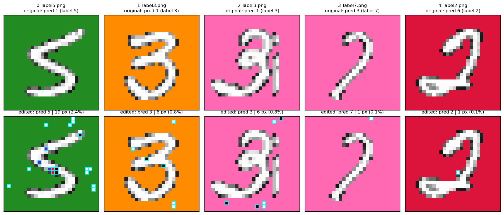
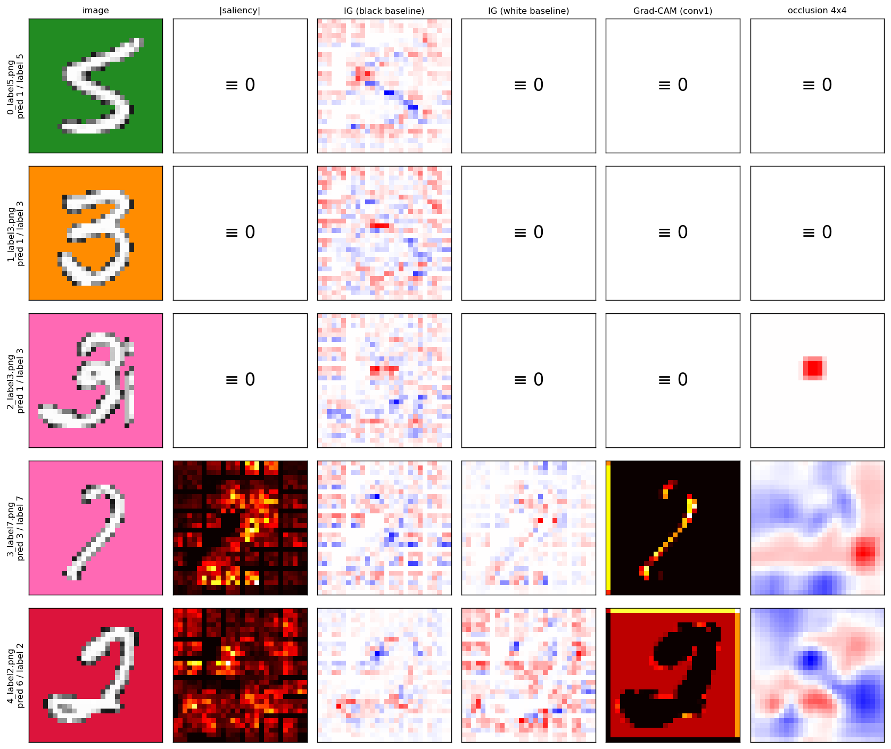

# Laboratorio 02 - Reto MNIST: edición mínima guiada por XAI

**Autor:** Bernardo Ordás Cernadas · **Personas en el grupo:** 1 · Código reproducible en `notebook/challenge.ipynb`

## 1. Resultado

| Imagen | Etiqueta | Pred. original | Pred. editada | Píxeles cambiados | **Píxeles conservados** | Unidad `fc1` clave (pre-activación) |
|---|---|---|---|---|---|---|
| 0_label5 | 5 | 1 | **5** | 19 | **97.58 %** | 7 (−10.64 → 1.03) |
| 1_label3 | 3 | 1 | **3** | 6 | **99.23 %** | 3 (−3.93 → 0.48) |
| 2_label3 | 3 | 1 | **3** | 6 | **99.23 %** | 3 (−3.26 → 0.48) |
| 3_label7 | 7 | 3 | **7** | 1 | **99.87 %** | 3 (0.61 → 1.30) |
| 4_label2 | 2 | 6 | **2** | 1 | **99.87 %** | 5 (1.23 → 2.33) |

Las 5 imágenes editadas (`data/MNIST/challenge/edited/`) pasan la celda de comprobación del notebook conservando
≥ 97.5 % de los píxeles (mínimo exigido: 60 %).

## 2. Diagnóstico: el modelo aprendió un atajo de color

En el conjunto `sample` (10 000 imágenes) cada dígito en gris está sobre un fondo uniforme de 6 colores, y **el color
codifica la paridad**: verde/naranja/rosa sólo aparecen con 1-3-5-7-9 y carmesí/azul/violeta con 0-2-4-6-8. El modelo
explota esa correlación espuria: acierta el 95 % en fondos "pares" y sólo ~50 % en "impares", donde casi únicamente
predice 1, 7 o 9. **El 5 se predice 2 veces en 10 000** (recall 0 %) y el 3 tiene un recall del 2 %. El reto contiene
precisamente un 5, dos 3, un 7 y un 2.

## 3. Insights XAI

**Mapas de atribución (saliency, Integrated Gradients, Grad-CAM, oclusión).** En las imágenes 0, 1 y 2 saliency,
Grad-CAM e IG con base blanca son *idénticamente cero* y la oclusión 4×4 apenas cambia nada. Además, las tres dan
exactamente la misma distribución de probabilidad: el modelo es "ciego" a ellas y los gradientes no sirven para guiar la
edición. En la 4, Grad-CAM de la clase 2 se concentra en el **fondo** y no en el trazo. En la 3, la oclusión muestra que
zonas sin trazo cambian la decisión: es una frontera muy frágil.

**Análisis de neuronas (`fc1`, 12 unidades).**
- 7 de las 12 unidades no se activan nunca. Las unidades 5, 7, 9 y 11 son **detectores de "fondo par"**: sólo se
  activan sobre fondos carmesí/azul/violeta (≤ 0.1 % de las veces en fondos impares), su pre-activación es muy negativa
  con colores con mucho verde (verde, naranja, rosa… y blanco) y en `fc2` penalizan todas las clases impares.
- En fondo impar, en la práctica, sólo puede activarse la **unidad 3**. El 57 % de las veces no hay ninguna activa y la salida es el sesgo
  de `fc2`, cuyo máximo es "1": es lo que pasa en las imágenes 0, 1 y 2.
- **Ventanas de activación** (deducidas de `fc2` con una única unidad activa): gana el **3** si a₃ ∈ (0.29, 0.96) y el
  **7** si a₃ ∈ (0.96, 4.24). La imagen 3 tiene a₃ = 0.61, y por eso sale 3. El **5 es inalcanzable con la unidad 3**:
  necesita una activación *moderada* de una unidad "par" (a₇ ∈ (0.83, 2.55) o a₁₁ ∈ (0.62, 2.04)), que penaliza más al
  1 y al 3 que al 5. El modelo sólo dice "5" si la imagen parece *un poco* par.

## 4. Método de edición

Como la salida es plana, en lugar del gradiente se usa la **pre-activación** (antes de la ReLU) de la unidad que indica
el análisis anterior. (1) *Despertar la unidad*: en cada paso se prueban todos los cambios de un píxel (784 posiciones ×
8 colores: los 6 fondos, blanco y negro) y se aplica el que más sube su pre-activación, lo que equivale a una oclusión
exhaustiva a nivel de neurona. (2) *Margen*: en cuanto la salida reacciona, se maximiza logit(etiqueta) − máx(resto)
hasta 0.05. (3) *Poda*: se revierten los píxeles que sobran. Para cada imagen se prueban las unidades vivas que tienen
ventana para su clase y se elige la edición con menos píxeles.

## 5. Por qué funciona cada edición (leave-one-out sobre la unidad clave)

- **0 → 5:** 19 píxeles (puntos blancos sobre el fondo y píxeles violeta/carmesí/negro sobre el trazo)
  repartidos por 22 de las 49 celdas de max-pooling. Como cada celda 4×4 sólo transmite su máximo, basta un píxel por
  celda. La unidad 7 pasa de −10.64 a 1.03, dentro de su ventana para el 5.
- **1, 2 → 3:** 6 píxeles llevan a₃ a 0.48, dentro de la ventana del 3. La mayor contribución entra por la celda (6, 4)
  de la fila inferior, donde la unidad 3 tiene sus pesos positivos más altos.
- **3 → 7:** un único píxel blanco en el borde superior, en la celda (0, 4) donde la unidad 3 tiene un peso alto, sube
  a₃ de 0.61 a 1.30 > 0.96.
- **4 → 2:** un único píxel blanco junto al trazo sube la unidad 5 de 1.23 a 2.33. Su peso en `fc2` favorece al 2
  frente al 6 en +0.78, y el margen pasa de −0.05 a +1.00.

Cada píxel editado aporta entre +0.27 y +1.35 a la pre-activación de la unidad clave. **Robustez:** las predicciones se
mantienen con aritmética bf16 (más gruesa que el TF32 de las GPU) y en 200 ensayos con un 0.2 % de ruido en los pesos.

## 6. Conclusión

El reto se resuelve con 1–19 píxeles porque el modelo no reconoce formas: usa un atajo de color, y en buena parte del
espacio de entrada todas sus ReLU están apagadas. La pista clave fue precisamente que los métodos de gradiente dieran
cero, porque eso obligó a analizar neuronas y pesos y a deducir qué patrón de activación produce cada clase. En la
práctica las ediciones son ejemplos adversariales: para una persona las imágenes no cambian. Para corregir el modelo
habría que romper la correlación color–paridad (fondos aleatorios, aumentación de color o entrada en gris) y evitar las
unidades muertas.
